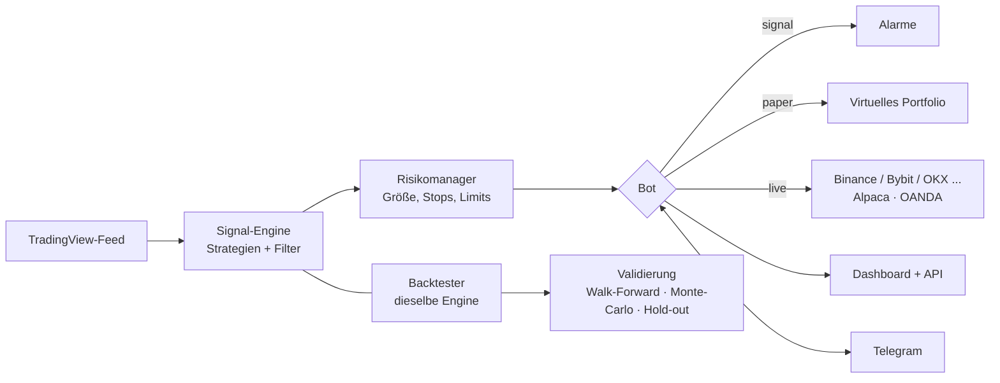

<div align="center">


# TV Hub

**Ein Live-TradingView-Dashboard und ein Trading-Bot, der sich große Mühe gibt, dich nicht zu täuschen.**

Signal-Alarme · Paper-Trading · echte Orders · ehrliches Backtesting · Steuerung per Telegram


[English](README.md) · [فارسی](README.fa.md) · **Deutsch**

</div>

> [!WARNING]
> **Nur für Bildung und Forschung. Das ist keine Finanzberatung**, und keine der enthaltenen Strategien ist garantiert profitabel. Beim Trading kannst du Geld verlieren. Die Pfade für echte Orders wurden nur gegen simulierte (gemockte) Börsen und Broker getestet. **Starte deshalb immer auf einem Testnet- oder Demokonto.**

<!-- Screenshot hier einfügen:   -->

## Warum TV Hub?

Die meisten Hobby-Trading-Bots zeigen dir eine hübsche Equity-Kurve und lassen dich daran glauben. TV Hub ist umgekehrt gebaut: Es geht davon aus, dass **jede Suche über viele Ideen etwas findet, das nur durch Zufall gut aussieht**, und ist darauf ausgelegt, genau das zu erkennen.

- Backtests füllen zur **Eröffnung der nächsten Kerze** und berechnen **marktspezifische Kosten** (Krypto, Aktien, Forex). Die Ergebnisse sind daher bewusst schwächer als bei naiven Backtests.
- Ein Ergebnis gilt erst als **belastbar**, wenn es Walk-Forward, Monte-Carlo, einen Block-Bootstrap-Test (korrigiert um die *Anzahl der ausprobierten Ideen*) und eine einmalige Prüfung auf **25 % der Daten, die nie eine Entscheidung beeinflusst haben**, besteht.
- Besteht nichts, sagt der Bericht das, statt dir das „Beste der Schlechten" zu zeigen.
- Backtester und Live-Bot nutzen **dieselbe Engine**. Was du testest, ist das, was läuft.

## Funktionen

| | |
|---|---|
| **Dashboard** | Live-TradingView-Daten, Signale, offene Positionen und ein Berichts-Tab (G&V, Trefferquote, Profit-Faktor, Drawdown, Aufschlüsselung je Symbol, CSV-Export). Auf dem Handy installierbar (PWA), passwortgeschützt, Englisch und Persisch. |
| **Drei Modi** | `signal` (nur Alarme) · `paper` (virtuelles Trading mit Gebühren und Slippage) · `live` (echte Orders). |
| **Strategien** | Vier eingebaute (RSI-Rücksetzer, Trendfolge, Ausbruch, MACD-Momentum-Umkehr), drei kombinierte Setups, ein No-Code-Kombi-Builder und eigene JavaScript-Strategien. |
| **KI-Helfer** *(optional)* | Beschreibe eine Idee in einfachen Worten und erhalte eine Strategie zum Backtesten. Die KI schreibt nie Code, sie füllt nur eine validierte Regelstruktur. Funktioniert mit Claude, jeder OpenAI-kompatiblen API oder einem kostenlosen lokalen Ollama. |
| **Risikomanagement** | ATR-Stops, Chance-Risiko-Ziele, Trailing-Stop, risikobasierte Positionsgröße, Exposure-Limits je Markt, Tagesverlustlimit, Stopp bei maximalem Drawdown, Cooldowns, Trendfilter. |
| **Validierung** | Walk-Forward, Monte-Carlo, Block-Bootstrap, Korrektur für Mehrfachtests, versiegelter Hold-out-Zeitraum und ein Forschungsbuch, das deine Versuche zählt. |
| **ML-Labor** | Ein Modell über viele Symbole, Meta-Labeling („nehmen oder überspringen“ für das Signal einer Strategie), echte marktspezifische Kosten und ein Auto-Runner für Leerlaufzeiten mit versiegelter Endprüfung. |
| **Forward-Evidenz** | Vergleicht die echten Ergebnisse des Bots mit einem Backtest über *dieselben Wochen*. |
| **MetaTrader 5** | Rein lesende EAs für lange Gold-/Forex-Historie und einen Live-Feed (ohne Python, ohne API-Schlüssel). |
| **Assistent** | Analyse je Strategie: was sie gerade sieht, Einstieg/Stop/Ziel und die simulierte Wahrscheinlichkeit, das Ziel vor dem Stop zu erreichen. Die Zahlen kommen aus dem Code; die KI formuliert sie nur um. |
| **Telegram** | Alarme, Tageszusammenfassung, wöchentlicher Evidenzbericht und Fernsteuerung: `/status` `/positions` `/pnl` `/close` `/halt` `/resume` `/panic`. |
| **Sicherheitsnetze** | Atomare Statusdateien, Erkennung beschädigter Dateien, börsenseitige Stops, Abgleich beim Start, Watchdog und Startverweigerung auf `0.0.0.0` ohne Passwort. |

## So funktioniert es



## Schnellstart

**Voraussetzung:** Node.js 18 oder neuer (20/22 empfohlen).

```bash
git clone https://github.com/medad21/tv-hub.git
cd tv-hub
```

| Plattform | Start |
|---|---|
| Windows | Doppelklick auf `start.bat` |
| macOS / Linux | `./start.sh` |
| Manuell | `npm install && cp .env.example .env && npm start` |

Das Skript installiert beim ersten Start die Abhängigkeiten und erstellt aus `.env.example` eine `.env`. Öffne dann **http://localhost:3000**.

Standard ist `MODE=signal`, das **nie Positionen eröffnet**.

### Docker (24/7-Betrieb)

```bash
cp .env.example .env     # MODE und ein starkes DASH_PASSWORD setzen
docker compose up -d
```

Startet nach einem Absturz oder Neustart automatisch neu, beendet sich für einen Neustart, wenn 5 Minuten keine Marktdaten kommen, und hält `state.json` sowie das Ereignislog in einem Volume.

> [!IMPORTANT]
> **Gib Port 3000 niemals ohne HTTPS ins Internet frei.** Nutze [Tailscale](https://tailscale.com) oder einen Cloudflare Tunnel. Für den Zugriff vom Handy setze `HOST=0.0.0.0` **und** ein starkes `DASH_PASSWORD`; ohne Passwort verweigert die App in diesem Fall den Start.

## Konfiguration

Alles steht in der `.env` (alle Optionen sind in [`.env.example`](.env.example) dokumentiert):

```env
MODE=signal                            # signal | paper | live
SYMBOLS=BINANCE:BTCUSDT,OANDA:XAUUSD   # EXCHANGE:TICKER; leer = eingebaute Liste mit 25
TIMEFRAME=60                           # 1, 5, 15, 30, 60, 240, D, W (Standard 15)
APP_LANG=en                            # Telegram, Berichte, Konsole: fa (Standard) | en
HOST=127.0.0.1
DASH_PASSWORD=
TELEGRAM_TOKEN=
TELEGRAM_CHAT_ID=
LIVE_CONFIRM=NO                        # muss YES sein, damit echte Orders platziert werden
```

> **Hinweis zur Sprache:** `APP_LANG` (Telegram, Berichte, Konsole) kennt nur `fa` (Standard) und `en`; Deutsch gibt es dort nicht. Das Dashboard hat einen Sprachschalter für English / فارسی.

Standardwerte für Strategie, Risiko und Filter stehen in `config.js`. Alles, was du im Dashboard anwendest, wird in `config.local.json` gespeichert. Jedes Symbol, das TradingView in der Form `EXCHANGE:TICKER` anbietet, kann beobachtet werden.

## Modi

| Modus | Was er tut |
|---|---|
| `signal` | Nur Alarme (Dashboard und Telegram) mit Strategie, vorgeschlagenem Einstieg, Stop, Ziel und Begründung. Der Bot ist **nur Long**: Ein Verkaufssignal bedeutet „schließen“, nicht „short gehen“. |
| `paper` | Virtuelles Trading mit 10.000 Einheiten Kapital, inklusive Gebühren und Slippage. |
| `live` | Echte Orders an Krypto-Börsen, US-Aktien (Alpaca) und Forex/Gold (OANDA). Benötigt Schlüssel **und** `LIVE_CONFIRM=YES`. Ein Symbol, dessen Broker keine Schlüssel hat, bleibt reines Signal. |

## Unterstützte Märkte

| Markt | Anbieter | Schlüssel |
|---|---|---|
| Krypto (Spot) | Binance, Bybit, OKX, KuCoin, Kraken, Coinbase, Bitget, Gate.io, MEXC (über [ccxt](https://github.com/ccxt/ccxt)) | `*_KEY`, `*_SECRET` (+ `*_PASSPHRASE` für OKX, KuCoin, Bitget) |
| US-Aktien | Alpaca (standardmäßig Paper) | `ALPACA_KEY`, `ALPACA_SECRET` |
| Forex und Gold | OANDA (standardmäßig Practice) | `OANDA_TOKEN`, `OANDA_ACCOUNT_ID` |

Verwende API-Schlüssel **nur mit Handelsrecht, niemals mit Auszahlungsrecht.** Ob ein Dienst für dich verfügbar ist, hängt von den Gesetzen deines Landes und den Bedingungen des Dienstes ab.

## Strategien

| Strategie | Idee |
|---|---|
| Vorübergehender Rücksetzer (RSI), *Standard* | Kauf bei scharfen überverkauften Einbrüchen, Verkauf bei Überkauft. |
| Trendfolge | Kauf, wenn der kurzfristige Durchschnitt über den langfristigen steigt. |
| Ausbruch | Kauf bei neuem 20-Kerzen-Hoch, Ausstieg bei neuem 20-Kerzen-Tief. |
| Momentum-Umkehr (MACD) | Kauf, wenn das Momentum nach oben dreht, Verkauf, wenn es nach unten dreht. |
| Kombinierte Setups | Rücksetzer im Aufwärtstrend · Ausbruch mit Momentum-Bestätigung · Konsens aus vier Strategien. |

Darüber hinaus kannst du **Kombis** ohne Code bauen, **JavaScript-Strategien** schreiben (kopiere `custom-strategies.example.js` nach `custom-strategies.user.js`) oder den **KI-Helfer** mit deinem eigenen Schlüssel nutzen. Der Schlüssel bleibt auf dem Server und wird nie an den Browser zurückgesendet.

> [!CAUTION]
> Eigene JavaScript-Strategien laufen im selben Prozess, ohne Sandbox. Führe nur Code aus, den du selbst geschrieben hast oder vollständig verstehst.

## Risikomanagement

ATR-basierter Stop (Standard 2×ATR) · Chance-Risiko-Ziel 1:2 · Trailing-Stop nach 1R · Positionsgröße aus festem Risiko je Trade (Standard 1 % des Kapitals) · Limit pro Einzelposition · Exposure-Limit je Marktgruppe · automatische Risikoreduktion bei sehr volatilen Symbolen · maximale gleichzeitige Positionen · Tagesverlustlimit · Stopp bei maximalem Drawdown · Cooldown nach jedem Schließen · EMA100-Trendfilter · Multi-Indikator-Bestätigungsfilter · optionale Teilausstiege (nur Krypto, nur live).

## Backtesting und Validierung

```bash
npm run backtest          # aktuelle Strategie auf historischen Kerzen ausführen
npm run sweep             # 270 Parameterkombinationen testen (Train/Test-Ranking)
npm run import-history -- --symbols BINANCE:BTCUSDT --tf 15,60 --from 2023-01
npm run import-crypto     # 1h-Kerzen für 8 große Paare seit 2021-01 (Prüfsummen-verifiziert)
```

Ein Ergebnis wird nur als **belastbar** eingestuft, wenn es **alle** diese Bedingungen erfüllt: mindestens 30 Trades · Profit-Faktor ≥ 1,2 · positives durchschnittliches R · profitabel in mindestens 3 von 5 Walk-Forward-Fenstern · geringe Monte-Carlo-Verlustwahrscheinlichkeit · Block-Bootstrap-Signifikanz, korrigiert um die Zahl der ausprobierten Ideen · eine einmalige Prüfung auf dem 25-%-Hold-out.

Ist `data.binance.vision` in deinem Netzwerk gesperrt, hänge `--proxy http://127.0.0.1:10809` an (oder setze `HISTORY_PROXY`). Downloads werden mit dem verglichen, was der Bot bereits archiviert hat, und Archiviertes wird nicht verändert.

<details>
<summary><b>ML-Labor: Multi-Symbol-Modell, Meta-Labeling, Auto-Runner</b></summary>

<br>

**Multi-Symbol-Test.** Wähle mehrere Archive mit *demselben Zeitrahmen* (z. B. alle `_60`) und starte. Standardmäßig ist das getestete Symbol gar nicht im Training, das Training nutzt nur Labels, die vor Beginn des Testblocks abgeschlossen waren, und Permutationstest sowie AUC-Intervall behalten die Korrelation zwischen den Symbolen bei. Ein Ergebnis, das nur bei ein oder zwei Symbolen gut ist, ist kein allgemeiner Vorteil. Läufe dauern einige Minuten (Limit 20 Archive).

**Meta-Labeling.** Wähle in derselben Box eine Strategie und starte. Die Strategie liefert die Signale (dieselben kantenerkannten Signale wie bei Backtest und Bot); das Modell entscheidet nur *nehmen oder überspringen*. Der Bericht vergleicht mit der einzig fairen Basis, **alle Signale zu nehmen**, und der Permutationstest verwendet eine zufällige Auswahl gleicher Größe. Vier oder mehr Archive eines Zeitrahmens funktionieren am besten.

**Echte marktspezifische Kosten.** Jedes Archiv wird mit den Kosten seines Marktes aus deinen Bot-Einstellungen (`risk.costs`) belastet, in ATR-Einheiten des Symbols umgerechnet und mit einem änderbaren Faktor multipliziert. Jeder Bericht zeigt, auf wie vielen Kerzen er beruht.

**Auto-Runner im Leerlauf.** Solange der Rechner im Leerlauf ist (Zeiten und CPU-Limit stellst du ein), arbeitet er *Strategie × Richtung × (Zeitrahmen, Markt)-Gruppe* mit demselben Test ab und führt eine Rangliste in `ml-auto.json`. Er handelt nie und berührt den Bot nicht. Weil die Suche über viele Kombinationen immer etwas findet, das nur durch Zufall gut aussieht, hat er drei Schutzmaßnahmen: Die neuesten Kerzen (standardmäßig die letzten 90 Tage plus alles, was künftig archiviert wird) sind **versiegelt**, und jeder Kandidat bekommt genau EINE Endprüfung darauf; jeder p-Wert wird zusätzlich mit der Zahl der getesteten Kombinationen multipliziert angezeigt; und jeder Lauf geht ins Forschungsbuch.

</details>

<details>
<summary><b>MetaTrader 5: lange Gold-/Forex-Historie und Live-Feed</b></summary>

<br>

TradingView liefert nur die letzten paar tausend Kerzen. MetaTrader 5 hält Jahre an Gold- und Forex-Daten auf dem Server deines Brokers, und TV Hub kann sie ohne Python und ohne API-Schlüssel lesen.

**Historienimport**

1. Kopiere `mt5/TvHubExport.mq5` in MT5s Ordner `MQL5\Scripts`, kompiliere es im MetaEditor (F7) und ziehe es auf einen Chart. Wähle Symbole und Zeitrahmen im Dialog. Es liest nur Historie und handelt nie.
2. Starte `import-mt5.bat` (oder `npm run import-mt5`). Nützliche Optionen: `--dry`, `--dir <Ordner>` (portables MT5), `--map "GOLD#=OANDA:XAUUSD"`, `--offset ny:7`.
3. Wähle im Backtest-Tab **Datenquelle: MetaTrader**. Der Live-Bot nutzt weiterhin TradingView.

MetaTrader-Kerzenzeiten sind die Serveruhr des Brokers, die meist mit der Sommerzeit wechselt. Der Import beweist die Uhr, indem er Kerzen mit den vom Bot archivierten TradingView-Kerzen abgleicht (führe also zuerst einen 1-Stunden-Backtest auf TradingView-Daten mit vielen Kerzen aus) und **speichert nichts, was er nicht belegen kann**. MetaTrader-Kerzen landen in einem separaten Archiv und werden nie mit TradingView-Daten vermischt.

**Live-Feed (nur lesend).** Kopiere `mt5/TvHubLive.mq5` nach `MQL5\Experts`, kompiliere es und ziehe es auf EINEN Chart. Alle 5 Sekunden schreibt es pro Symbol eine JSON-Datei (Bid/Ask/Spread, die neuesten 300 geschlossenen Kerzen von M15/H1/H4/D1, offene Positionen, Kontosummen; nie dein Login oder Name). Es kann nicht handeln.

- `GET /api/mt5/live`: Ordner- und Dateistatus
- `GET /api/mt5/live/XAUUSD`: Preis, Spread, Positionen, Kontosummen (`?candles=50` fügt Kerzen hinzu)
- `GET /api/mt5/live/XAUUSD/structure?tf=60`: Marktstruktur auf den Live-Kerzen

Daten, die älter als `MT5_LIVE_MAX_AGE_SEC` (Standard 30) sind, kommen mit `fresh: false` und einem Grund zurück.

> Keines der beiden MQL5-Skripte konnte in der Entwicklungsumgebung kompiliert werden. Probiere sie zuerst auf einem Demokonto aus.

**Marktstruktur** (`market-structure.js`): Swing-Hochs/-Tiefs (ohne Blick in die Zukunft), nach ATR geclusterte Unterstützungs-/Widerstandszonen, Trendstruktur (HH/HL, LH/LL, BOS/CHoCH) und der Zustand jedes *Ausbruchs + Pullbacks*. Strategien erhalten sie über `ctx.structure()`, `ctx.swingHigh(n)` und `ctx.swingLow(n)`. Sie misst nur; über Trades entscheidet sie nichts.

</details>

<details>
<summary><b>Assistent: Analyse je Strategie mit optionaler lokaler KI</b></summary>

<br>

`GET /api/assistant/analyze?symbol=OANDA:XAUUSD&tf=60` liefert für jede Strategie: was sie gerade sieht, ob ihre Einstiegsbedingungen erfüllt sind, Einstieg/Stop/Ziel nach den Risikoregeln, die **Wahrscheinlichkeit, das Ziel vor dem Stop zu erreichen**, in den nächsten N Kerzen, was der gespeicherte Backtest-Vergleich ergeben hat, und Warnhinweise (veraltete Daten, großer Spread, blockierter Trendfilter).

- **Alle Zahlen kommen aus dem Code** (`analysis-context.js`, `market-structure.js`, `forecast.js`). Der Bericht funktioniert ganz ohne KI.
- **Wahrscheinlichkeiten** stammen aus Tausenden simulierter Zukünfte, die aus aneinandergereihten Blöcken der jüngsten Kerzen des Marktes bei heutiger Volatilität gebaut werden, wobei der historische Drift absichtlich entfernt ist: Sie sagt, wie weit der Preis typischerweise läuft, nie *in welche Richtung*. `GET /api/assistant/calibration` spielt die Methode über das Archiv noch einmal ab und zeigt, ob „40 %“ tatsächlich in etwa 40 % der Fälle eintrat.
- **Die KI formuliert nur um.** Mit einem kostenlosen lokalen [Ollama](https://ollama.com) (`install-ollama.bat` / `bash install-ollama.sh`, oder `ollama pull qwen2.5:7b` plus die drei `AI_*`-Zeilen in der `.env`) oder einem beliebigen Anbieter in den KI-Einstellungen erhält das Modell die Fakten als JSON und formuliert sie um. Jede Zahl, die es schreibt, muss in den Fakten vorkommen, sonst wird sein Text verworfen und der Text des Codes angezeigt.
- `GET /api/assistant/status` zeigt, ob Ollama läuft und was zu tun ist, falls nicht. Setze in Docker `OLLAMA_HOST=http://host.docker.internal:11434`.

</details>

## Telegram

Erstelle einen Bot mit `@BotFather` und verbinde ihn über das Dashboard-Panel oder die `.env`. Du erhältst Signal-Alarme, Start- und Ausfallmeldungen, eine Tageszusammenfassung und einen wöchentlichen Evidenzbericht, und du kannst den Bot **nur aus dem registrierten Chat** steuern. Ein optionaler HTTP-Proxy wird ausschließlich für Telegram unterstützt.

## Bevor du echtes Geld einsetzt

1. `npm test`
2. `npm run backtest` und `npm run sweep` auf echten Daten
3. Mehrere Wochen `MODE=paper`
4. `MODE=live` auf einem Testnet- oder Demokonto (`EXCHANGE_TESTNET=YES`, `ALPACA_PAPER=YES`, `OANDA_PRACTICE=YES`)
5. Erst dann: echte Schlüssel, ein sehr kleines `capitalUsdt` und `LIVE_CONFIRM=YES`

## Projektstruktur

```
tv-hub/
├── server.js                     HTTP-Server, Dashboard, API
├── bot.js · risk.js · config.js  Bot, Risikobehandlung, Einstellungen
├── strategy.js · rules.js        Indikatoren, eingebaute und regelbasierte Strategien
├── custom-strategies*.js         Deine eigenen Strategien
├── backtest*.js · significance.js · trials.js · evidence.js
│                                 Backtesting und statistische Validierung
├── ml*.js                        ML-Labor (einzeln, gepoolt, Meta-Labeling, Auto-Runner)
├── assistant*.js · forecast.js · analysis-context.js · market-structure.js
│                                 Analyse-Assistent
├── mt5-*.js · mt5/               MetaTrader-5-Import, Live-Leser, MQL5-Skripte
├── history-import.js · candle-store.js
│                                 Import langer Historie und Kerzenarchiv
├── broker-alpaca.js · broker-oanda.js
├── telegram*.js · notify.js · summary.js
├── ai*.js                        Optionaler KI-Strategiehelfer
├── public/                       Dashboard-Frontend (PWA)
└── test*.js                      30 Offline-Testdateien
```

## Tests

```bash
npm test
```

30 Testdateien, rund 1.100 Prüfungen, vollständig offline gegen simulierte Börsen und Broker. Sie decken Risikologik, Broker, Backtesting, Statistik, Alarme, Zuverlässigkeit, eigene Strategien, den KI-Helfer, Live-Trading-Sicherheit, das ML-Labor und mehr ab.

## Bekannte Einschränkungen

- Die Marktdaten stammen aus einer **inoffiziellen** TradingView-Bibliothek, die bei Änderungen von TradingView kaputtgehen kann.
- Stop-Loss und Take-Profit werden von der App überwacht. Börsenseitige Stops sind für Krypto standardmäßig aktiv, ein Trailing-Stop bewegt sich aber nur innerhalb der App (bei Alpaca und OANDA bleibt der brokerseitige Stop fest).
- Kurslücken (Gaps) können Verluste verursachen, die größer sind als der Stop.
- Der Import langer Historie funktioniert nur für Binance Spot; Aktien und Forex sind auf das beschränkt, was TradingView liefert, plus das wachsende lokale Archiv (bzw. MetaTrader für Forex/Gold).
- Die englische Übersetzung deckt die ganze App ab, eine selten angezeigte Meldung kann aber noch auf Persisch erscheinen. Führe `I18N_MISSING()` in der Browser-Konsole aus, um sie aufzulisten.

## Mitwirken

Issues und Pull Requests sind willkommen. Bitte führe vor dem Öffnen eines PR `npm test` aus und committe niemals `.env`, API-Schlüssel oder die in `.gitignore` aufgeführten Laufzeitdateien.

## Credits

Erstellt von **Ehsan Bagheryane** ([@medad21](https://github.com/medad21)).

Gebaut auf [@mathieuc/tradingview](https://github.com/Mathieu2301/TradingView-API), [ccxt](https://github.com/ccxt/ccxt), [Express](https://expressjs.com) und [ws](https://github.com/websockets/ws).
