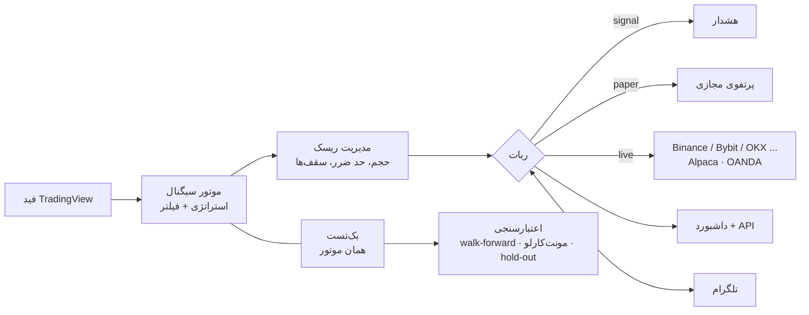

<div align="center">


# TV Hub

**داشبورد زنده‌ی TradingView و رباتی که تا جای ممکن نمی‌گذارد خودت را گول بزنی.**

هشدار سیگنال · معامله‌ی آزمایشی · سفارش واقعی · بک‌تست صادقانه · کنترل از تلگرام


[English](README.md) · **فارسی** · [Deutsch](README.de.md)

</div>

<div dir="rtl">

> [!WARNING]
> **فقط برای آموزش و پژوهش. توصیه‌ی مالی نیست** و هیچ‌کدام از استراتژی‌های این پروژه سودآوری تضمین‌شده ندارد. معامله می‌تواند باعث ضرر شود. بخش سفارش واقعی فقط با صرافی و کارگزار جعلی (mock) تست شده؛ پس **همیشه اول روی Testnet یا حساب آزمایشی امتحان کنید.**

<!-- اسکرین‌شات داشبورد را اینجا بگذارید:   -->

## چرا TV Hub؟

بیشتر ربات‌های معامله‌ی خانگی یک نمودار سود قشنگ نشانت می‌دهند و می‌گذارند باورش کنی. TV Hub برعکس ساخته شده: فرضش این است که **هر جست‌وجو بین ایده‌های زیاد، چیزی پیدا می‌کند که فقط به‌خاطر شانس خوب به نظر می‌رسد** و برای گرفتن همین ساخته شده.

- بک‌تست در **باز شدن کندل بعدی** پر می‌شود و **هزینه‌ی هر بازار** (کریپتو، سهام، فارکس) را حساب می‌کند؛ پس نتیجه‌ها عمداً ضعیف‌تر از بک‌تست‌های ساده است.
- نتیجه فقط وقتی **قابل اتکا** نامیده می‌شود که از Walk-forward، مونت‌کارلو، آزمون بلوک‌بوت‌استرپ (با اصلاح برای *تعداد ایده‌هایی که امتحان کرده‌ای*) و یک بررسی یک‌باره روی **۲۵٪ داده‌ای که در هیچ تصمیمی نقش نداشته** رد شود.
- اگر چیزی رد نشود، گزارش همین را می‌گوید و «بهترینِ بدها» را جلویت نمی‌گذارد.
- بک‌تست و ربات زنده **یک موتور مشترک** دارند؛ پس چیزی که تست می‌کنی همان چیزی است که اجرا می‌شود.

## امکانات

| | |
|---|---|
| **داشبورد** | داده‌ی زنده‌ی TradingView، سیگنال‌ها، پوزیشن‌های باز و تب گزارش (سود/زیان، درصد برد، ضریب سود، افت سرمایه، تفکیک هر نماد، خروجی CSV). قابل نصب روی گوشی (PWA)، رمزدار، فارسی و انگلیسی. |
| **سه حالت** | `signal` (فقط هشدار) · `paper` (معامله‌ی مجازی با کارمزد و لغزش) · `live` (سفارش واقعی). |
| **استراتژی‌ها** | چهار استراتژی آماده (اصلاح RSI، دنبال‌کردن روند، شکست سطح، برگشت شتاب MACD)، سه ستاپ ترکیبی، سازنده‌ی ترکیب بدون کدنویسی و استراتژی‌های JavaScript خودت. |
| **دستیار هوش مصنوعی** *(اختیاری)* | ایده را با کلمات ساده بگو و استراتژی‌ای بگیر که بعد بک‌تستش کنی. هوش مصنوعی هرگز کد نمی‌نویسد؛ فقط یک ساختار قانون اعتبارسنجی‌شده را پر می‌کند. با Claude، هر سرویس سازگار با OpenAI یا Ollama‌ی محلیِ رایگان کار می‌کند. |
| **مدیریت ریسک** | حد ضرر ATR، هدف ریسک به ریوارد، تریلینگ استاپ، حجم بر پایه‌ی ریسک، سقف مواجهه‌ی هر بازار، سقف ضرر روزانه، توقف در افت بیش‌ازحد، زمان انتظار و فیلتر روند. |
| **اعتبارسنجی** | Walk-forward، مونت‌کارلو، بلوک‌بوت‌استرپ، اصلاح آزمون‌های چندگانه، بازه‌ی کنارگذاشته‌شده و دفتر پژوهشی که تعداد آزمایش‌هایت را می‌شمارد. |
| **آزمایشگاه ML** | یک مدل روی چند نماد، متا‌لیبلینگ («بگیر یا رد کن» برای سیگنال یک استراتژی)، هزینه‌ی واقعی هر بازار و اجراکننده‌ی خودکار در زمان بیکاری با بررسی نهایی روی داده‌ی مهروموم‌شده. |
| **شواهد رو‌به‌جلو** | نتیجه‌ی واقعی ربات را با بک‌تستِ *همان هفته‌ها* مقایسه می‌کند. |
| **متاتریدر ۵** | اکسپرت فقط‌خواندنی برای تاریخچه‌ی بلند طلا/فارکس و فید زنده (بدون Python و بدون کلید API). |
| **دستیار تحلیل** | تحلیل هر استراتژی: الان چه می‌بیند، ورود/حد ضرر/هدف، و احتمال شبیه‌سازی‌شده‌ی رسیدن به هدف پیش از حد ضرر. اعداد را کد می‌دهد؛ هوش مصنوعی فقط بازنویسی می‌کند. |
| **تلگرام** | هشدار، خلاصه‌ی روزانه، گزارش هفتگی شواهد و کنترل از راه دور: `/status` `/positions` `/pnl` `/close` `/halt` `/resume` `/panic`. |
| **شبکه‌ی ایمنی** | فایل‌های وضعیت اتمیک، تشخیص خرابی فایل، استاپ سمت صرافی، تطبیق هنگام شروع، واچ‌داگ و امتناع از شروع روی `0.0.0.0` بدون رمز. |

## چطور کار می‌کند



## شروع سریع

**پیش‌نیاز:** Node.js نسخه‌ی ۱۸ یا بالاتر (۲۰ یا ۲۲ پیشنهاد می‌شود).

```bash
git clone https://github.com/medad21/tv-hub.git
cd tv-hub
```

| سیستم‌عامل | اجرا |
|---|---|
| ویندوز | دوبار کلیک روی `start.bat` |
| macOS / Linux | `./start.sh` |
| دستی | `npm install && cp .env.example .env && npm start` |

اسکریپت در اولین اجرا وابستگی‌ها را نصب می‌کند و از `.env.example` فایل `.env` می‌سازد. بعد **http://localhost:3000** را باز کن.

حالت پیش‌فرض `MODE=signal` است که **هرگز پوزیشن باز نمی‌کند**.

### داکر (اجرای ۲۴ ساعته)

```bash
cp .env.example .env     # MODE و یک DASH_PASSWORD قوی بگذار
docker compose up -d
```

بعد از کرش یا ری‌استارت سرور دوباره بالا می‌آید؛ اگر ۵ دقیقه داده‌ی بازار نیاید برنامه خارج می‌شود تا داکر ری‌استارتش کند؛ `state.json` و لاگ رویدادها در یک ولوم می‌مانند.

> [!IMPORTANT]
> **پورت ۳۰۰۰ را بدون HTTPS روی اینترنت باز نگذار.** از [Tailscale](https://tailscale.com) یا Cloudflare Tunnel استفاده کن. برای دسترسی از گوشی، `HOST=0.0.0.0` **و** یک `DASH_PASSWORD` قوی بگذار؛ در این حالت برنامه بدون رمز شروع نمی‌شود.

## تنظیمات

همه‌چیز در `.env` است (همه‌ی گزینه‌ها در [`.env.example`](.env.example) توضیح داده شده‌اند):

```env
MODE=signal                            # signal | paper | live
SYMBOLS=BINANCE:BTCUSDT,OANDA:XAUUSD   # EXCHANGE:TICKER؛ خالی = فهرست آماده‌ی ۲۵ نمادی
TIMEFRAME=60                           # 1, 5, 15, 30, 60, 240, D, W (پیش‌فرض 15)
APP_LANG=fa                            # تلگرام، گزارش‌ها و کنسول: fa (پیش‌فرض) | en
HOST=127.0.0.1
DASH_PASSWORD=
TELEGRAM_TOKEN=
TELEGRAM_CHAT_ID=
LIVE_CONFIRM=NO                        # برای سفارش واقعی باید YES باشد
```

پیش‌فرض‌های استراتژی، ریسک و فیلترها در `config.js` هستند. هرچه از داشبورد اعمال کنی در `config.local.json` ذخیره می‌شود. هر نمادی که TradingView به شکل `EXCHANGE:TICKER` بدهد قابل دیدن است.

## حالت‌ها

| حالت | چه می‌کند |
|---|---|
| `signal` | فقط هشدار (داشبورد و تلگرام) همراه با استراتژی، ورود پیشنهادی، حد ضرر، هدف و دلیل. ربات **فقط خرید (Long)** دارد: سیگنال فروش یعنی «ببند»، نه «شورت بزن». |
| `paper` | معامله‌ی مجازی با سرمایه‌ی ۱۰٬۰۰۰ واحد، شامل کارمزد و لغزش. |
| `live` | سفارش واقعی روی صرافی‌های کریپتو، سهام آمریکا (Alpaca) و فارکس/طلا (OANDA). کلید **و** `LIVE_CONFIRM=YES` لازم است. نمادی که کارگزارش کلید ندارد، فقط سیگنال می‌ماند. |

## بازارها و کارگزارها

| بازار | سرویس | کلیدها |
|---|---|---|
| کریپتو (اسپات) | Binance، Bybit، OKX، KuCoin، Kraken، Coinbase، Bitget، Gate.io، MEXC (با [ccxt](https://github.com/ccxt/ccxt)) | `*_KEY`، `*_SECRET` (+ `*_PASSPHRASE` برای OKX، KuCoin، Bitget) |
| سهام آمریکا | Alpaca (پیش‌فرض آزمایشی) | `ALPACA_KEY`، `ALPACA_SECRET` |
| فارکس و طلا | OANDA (پیش‌فرض حساب آزمایشی) | `OANDA_TOKEN`، `OANDA_ACCOUNT_ID` |

کلید API را فقط با **دسترسی معامله بساز، هرگز با دسترسی برداشت.** در دسترس بودن هر سرویس به قوانین کشورت و شرایط خود سرویس بستگی دارد.

## استراتژی‌ها

| استراتژی | ایده |
|---|---|
| اصلاح موقت (RSI) — *پیش‌فرض* | خرید در افت‌های تند و اشباع فروش، فروش در اشباع خرید. |
| دنبال‌کردن روند | خرید وقتی میانگین کوتاه‌مدت از بلندمدت بالاتر می‌رود. |
| شکست سطح | خرید در سقف جدید ۲۰ کندلی، خروج در کف جدید ۲۰ کندلی. |
| برگشت شتاب (MACD) | خرید وقتی شتاب رو به بالا می‌شود، فروش وقتی رو به پایین. |
| ستاپ‌های ترکیبی | اصلاح در روند صعودی · شکست با تأیید شتاب · اجماع چهار استراتژی. |

علاوه بر این می‌توانی **ترکیب** بدون کدنویسی بسازی، **استراتژی JavaScript** بنویسی (`custom-strategies.example.js` را به `custom-strategies.user.js` کپی کن) یا از **دستیار هوش مصنوعی** با کلید خودت استفاده کنی. کلید فقط روی سرور می‌ماند و هرگز به مرورگر برنگردانده می‌شود.

> [!CAUTION]
> استراتژی‌های JavaScript در همان پروسه و بدون سندباکس اجرا می‌شوند. فقط کدی را اجرا کن که خودت نوشته‌ای یا کامل می‌فهمی.

## مدیریت ریسک

حد ضرر بر پایه‌ی ATR (پیش‌فرض ۲×ATR) · هدف ریسک به ریوارد ۱:۲ · تریلینگ استاپ بعد از ۱R · حجم پوزیشن از ریسک ثابت هر معامله (پیش‌فرض ۱٪ سرمایه) · سقف یک پوزیشن · سقف مواجهه‌ی هر گروه بازار · کاهش خودکار ریسک روی نمادهای خیلی نوسانی · حداکثر پوزیشن هم‌زمان · سقف ضرر روزانه · توقف در افت سرمایه‌ی زیاد · زمان انتظار بعد از هر بسته‌شدن · فیلتر روند EMA100 · فیلتر تأیید چنداندیکاتوری · خروج پله‌ای اختیاری (فقط کریپتو در حالت واقعی).

## بک‌تست و اعتبارسنجی

```bash
npm run backtest          # استراتژی فعلی روی کندل‌های تاریخی
npm run sweep             # ۲۷۰ ترکیب پارامتر (رتبه‌بندی train/test)
npm run import-history -- --symbols BINANCE:BTCUSDT --tf 15,60 --from 2023-01
npm run import-crypto     # کندل ۱ساعته‌ی ۸ جفت‌ارز بزرگ از ۲۰۲۱-۰۱ (با بررسی checksum)
```

نتیجه فقط وقتی **قابل اتکا** است که **همه‌ی** این‌ها را بگذراند: دست‌کم ۳۰ معامله · ضریب سود ≥ ۱٫۲ · میانگین R مثبت · سودده در دست‌کم ۳ از ۵ بازه‌ی walk-forward · احتمال ضرر پایین در مونت‌کارلو · معناداری بلوک‌بوت‌استرپ با اصلاح برای تعداد ایده‌های امتحان‌شده · یک بررسی یک‌باره روی ۲۵٪ داده‌ی کنارگذاشته.

اگر `data.binance.vision` در شبکه‌ات بسته است، `--proxy http://127.0.0.1:10809` را اضافه کن (یا `HISTORY_PROXY` را بگذار). دانلودها با آنچه ربات قبلاً آرشیو کرده مقایسه می‌شوند و چیزِ آرشیوشده تغییر نمی‌کند.

<details>
<summary><b>آزمایشگاه ML: مدل چندنمادی، متا‌لیبلینگ، اجراکننده‌ی خودکار</b></summary>

<br>

**آزمون چندنمادی.** چند آرشیو با **همان تایم‌فریم** (مثلاً همه‌ی `_60`) را انتخاب و اجرا کن. به‌طور پیش‌فرض نمادِ تست‌شده اصلاً در آموزش نیست، آموزش فقط از برچسب‌هایی استفاده می‌کند که پیش از شروع بلوک تست تمام شده‌اند، و آزمون جایگشت و بازه‌ی AUC همبستگی بین نمادها را نگه می‌دارند. نتیجه‌ای که فقط روی یکی دو نماد خوب است، مزیت عمومی نیست. اجرا چند دقیقه طول می‌کشد (حداکثر ۲۰ آرشیو).

**متا‌لیبلینگ.** یک استراتژی انتخاب کن و در همان بخش اجرا کن. استراتژی سیگنال می‌دهد (همان سیگنال‌های لبه‌یابی‌شده‌ای که بک‌تست و ربات استفاده می‌کنند) و مدل فقط تصمیم می‌گیرد *بگیر یا رد کن*. گزارش با تنها مبنای منصفانه، یعنی **گرفتن همه‌ی سیگنال‌ها**، مقایسه می‌شود و آزمون جایگشت از انتخاب تصادفی هم‌اندازه استفاده می‌کند. چهار آرشیو یا بیشتر از یک تایم‌فریم بهترین نتیجه را می‌دهد.

**هزینه‌ی واقعی هر بازار.** هر آرشیو هزینه‌ی بازار خودش را از تنظیمات ربات (`risk.costs`) می‌گیرد، به واحد ATR همان نماد تبدیل می‌شود و در ضریبی که می‌توانی عوض کنی ضرب می‌شود. هر گزارش نشان می‌دهد روی چند کندل بنا شده است.

**اجراکننده‌ی خودکار در زمان بیکاری.** وقتی کامپیوتر بیکار است (ساعت‌ها و سقف CPU را خودت تعیین می‌کنی) با همان آزمون روی *استراتژی × جهت × گروه (تایم‌فریم، بازار)* می‌گردد و جدول برترین‌ها را در `ml-auto.json` نگه می‌دارد. هرگز معامله نمی‌کند و به ربات دست نمی‌زند. چون جست‌وجو بین ترکیب‌های زیاد همیشه چیزی پیدا می‌کند که به شانس خوب به نظر می‌رسد، سه محافظ دارد: تازه‌ترین کندل‌ها (پیش‌فرض ۹۰ روز آخر + هرچه از این به بعد آرشیو شود) **مهروموم** می‌شوند و هر نامزد فقط یک‌بار روی آن‌ها بررسی نهایی می‌شود؛ هر p-value در تعداد ترکیب‌های امتحان‌شده هم ضرب و نشان داده می‌شود؛ و هر اجرا وارد دفتر پژوهشی می‌شود.

</details>

<details>
<summary><b>متاتریدر ۵: تاریخچه‌ی بلند طلا/فارکس و فید زنده</b></summary>

<br>

TradingView فقط چند هزار کندل آخر را می‌دهد. متاتریدر ۵ سال‌ها تاریخچه‌ی طلا و فارکس را روی سرور کارگزارت نگه می‌دارد و TV Hub می‌تواند آن را بدون Python و بدون کلید API بخواند.

**واردکردن تاریخچه**

1. فایل `mt5/TvHubExport.mq5` را در پوشه‌ی `MQL5\Scripts` متاتریدر کپی کن، در MetaEditor کامپایل کن (F7) و روی یک چارت بکش. نمادها و تایم‌فریم‌ها را در پنجره انتخاب کن. فقط تاریخچه می‌خواند و هرگز معامله نمی‌کند.
2. `import-mt5.bat` (یا `npm run import-mt5`) را اجرا کن. گزینه‌های مفید: `--dry`، `--dir <folder>` (متاتریدر پرتابل)، `--map "GOLD#=OANDA:XAUUSD"`، `--offset ny:7`.
3. در تب بک‌تست **منبع داده: MetaTrader** را انتخاب کن. ربات زنده همچنان از TradingView می‌خواند.

زمان کندل‌های متاتریدر ساعت سرور کارگزار است که معمولاً با ساعت تابستانی جابه‌جا می‌شود. واردکننده ساعت را با هم‌ردیف‌کردن کندل‌ها با کندل‌های TradingView که ربات آرشیو کرده **اثبات** می‌کند (پس اول یک بک‌تست ۱ساعته با کندل زیاد روی داده‌ی TradingView بزن) و **چیزی را که نتواند اثبات کند ذخیره نمی‌کند**. کندل‌های متاتریدر در آرشیو جدا می‌روند و هرگز با داده‌ی TradingView قاطی نمی‌شوند.

**فید زنده (فقط‌خواندنی).** `mt5/TvHubLive.mq5` را در `MQL5\Experts` کپی کن، کامپایل کن و روی فقط یک چارت بکش. هر ۵ ثانیه برای هر نماد یک فایل JSON می‌نویسد (bid/ask/spread، ۳۰۰ کندل بسته‌ی اخیر M15/H1/H4/D1، پوزیشن‌های باز، جمع حساب؛ هرگز لاگین یا نام تو). نمی‌تواند معامله کند.

- `GET /api/mt5/live`: وضعیت پوشه و فایل‌ها
- `GET /api/mt5/live/XAUUSD`: قیمت، اسپرد، پوزیشن‌ها، جمع حساب (`?candles=50` کندل هم اضافه می‌کند)
- `GET /api/mt5/live/XAUUSD/structure?tf=60`: ساختار بازار روی کندل‌های زنده

داده‌ی قدیمی‌تر از `MT5_LIVE_MAX_AGE_SEC` (پیش‌فرض ۳۰) با `fresh: false` و دلیلش برمی‌گردد.

> هیچ‌کدام از دو اسکریپت MQL5 در محیط توسعه کامپایل نشده‌اند. اول روی حساب دمو امتحان کن.

**ساختار بازار** (`market-structure.js`): سقف/کف‌های نوسانی (بدون نگاه به آینده)، **ناحیه‌های** حمایت/مقاومت خوشه‌بندی‌شده با ATR، ساختار روند (HH/HL، LH/LL، BOS/CHoCH) و وضعیت هر *شکست + پولبک*. استراتژی‌ها آن را با `ctx.structure()`، `ctx.swingHigh(n)` و `ctx.swingLow(n)` می‌گیرند. فقط اندازه می‌گیرد؛ درباره‌ی معامله تصمیمی نمی‌گیرد.

</details>

<details>
<summary><b>دستیار: تحلیل هر استراتژی با هوش مصنوعی محلی (اختیاری)</b></summary>

<br>

`GET /api/assistant/analyze?symbol=OANDA:XAUUSD&tf=60` برای هر استراتژی برمی‌گرداند: الان چه می‌بیند، شرط‌های ورودش برقرار است یا نه، ورود/حد ضرر/هدفی که قوانین ریسک می‌گذارند، **احتمال رسیدن به هدف پیش از حد ضرر** در N کندل بعد، مقایسه‌ی بک‌تستِ ذخیره‌شده چه گفته، و هشدارها (داده‌ی کهنه، اسپرد زیاد، فیلتر روند بسته).

- **همه‌ی اعداد از کد می‌آیند** (`analysis-context.js`، `market-structure.js`، `forecast.js`). گزارش بدون هیچ هوش مصنوعی هم کار می‌کند.
- **احتمال‌ها** از هزاران آینده‌ی شبیه‌سازی‌شده می‌آیند که با زنجیر کردن بلوک‌های کندل‌های اخیر خودِ بازار با نوسان امروز ساخته می‌شوند و رانش تاریخی عمداً حذف شده است: می‌گوید قیمت معمولاً چقدر می‌رود، نه *به کدام سو*. `GET /api/assistant/calibration` روش را روی آرشیو دوباره اجرا می‌کند و می‌گوید «۴۰٪» واقعاً حدود ۴۰٪ مواقع رخ داده یا نه.
- **هوش مصنوعی فقط بازنویسی می‌کند.** با [Ollama](https://ollama.com) رایگان و محلی (`install-ollama.bat` / `bash install-ollama.sh`، یا `ollama pull qwen2.5:7b` و سه خط `AI_*` در `.env`) یا هر سرویس در تنظیمات هوش مصنوعی، مدل حقایق را به‌شکل JSON می‌گیرد و بازنویسی می‌کند. هر عددی که بنویسد باید در حقایق باشد، وگرنه متنش دور ریخته و متن کد نشان داده می‌شود.
- `GET /api/assistant/status` نشان می‌دهد Ollama روشن است یا نه و اگر نیست چه کنی. در داکر `OLLAMA_HOST=http://host.docker.internal:11434` را بگذار.

</details>

## تلگرام

با `@BotFather` یک ربات بساز و از پنل داشبورد یا `.env` وصلش کن. هشدار سیگنال، پیام شروع و قطعی، خلاصه‌ی روزانه و گزارش هفتگی شواهد می‌گیری و ربات را **فقط از چت ثبت‌شده** می‌توانی کنترل کنی. پروکسی HTTP اختیاری فقط برای تلگرام پشتیبانی می‌شود.

## قبل از معامله‌ی واقعی

1. `npm test`
2. `npm run backtest` و `npm run sweep` روی داده‌ی واقعی
3. چند هفته `MODE=paper`
4. `MODE=live` روی Testnet یا حساب آزمایشی (`EXCHANGE_TESTNET=YES`، `ALPACA_PAPER=YES`، `OANDA_PRACTICE=YES`)
5. فقط بعد از آن: کلید واقعی، `capitalUsdt` خیلی کوچک و `LIVE_CONFIRM=YES`

## ساختار پروژه

```
tv-hub/
├── server.js                     سرور HTTP، داشبورد، API
├── bot.js · risk.js · config.js  ربات، مدیریت ریسک، تنظیمات
├── strategy.js · rules.js        اندیکاتورها، استراتژی‌های آماده و قانون‌محور
├── custom-strategies*.js         استراتژی‌های خودت
├── backtest*.js · significance.js · trials.js · evidence.js
│                                 بک‌تست و اعتبارسنجی آماری
├── ml*.js                        آزمایشگاه ML (تکی، چندنمادی، متا‌لیبلینگ، اجراکننده‌ی خودکار)
├── assistant*.js · forecast.js · analysis-context.js · market-structure.js
│                                 دستیار تحلیل
├── mt5-*.js · mt5/               واردکننده‌ی متاتریدر ۵، خواننده‌ی زنده، اسکریپت‌های MQL5
├── history-import.js · candle-store.js
│                                 واردکردن تاریخچه‌ی بلند و آرشیو کندل
├── broker-alpaca.js · broker-oanda.js
├── telegram*.js · notify.js · summary.js
├── ai*.js                        دستیار اختیاری استراتژی با هوش مصنوعی
├── public/                       رابط داشبورد (PWA)
└── test*.js                      ۳۰ فایل تست آفلاین
```

## تست‌ها

```bash
npm test
```

۳۰ فایل تست و حدود ۱٬۱۰۰ بررسی، کاملاً آفلاین روی صرافی و کارگزار جعلی. ریسک، کارگزارها، بک‌تست، آمار، هشدارها، پایداری، استراتژی‌های سفارشی، دستیار هوش مصنوعی، ایمنی معامله‌ی واقعی، آزمایشگاه ML و موارد دیگر را پوشش می‌دهند.

## محدودیت‌های شناخته‌شده

- داده‌ی بازار از یک کتابخانه‌ی **غیررسمی** TradingView می‌آید که با تغییر TradingView ممکن است خراب شود.
- حد ضرر و حد سود را خود برنامه پایش می‌کند. استاپ سمت صرافی برای کریپتو به‌طور پیش‌فرض روشن است، اما تریلینگ استاپ فقط داخل برنامه حرکت می‌کند (استاپ سمت کارگزار در Alpaca و OANDA ثابت می‌ماند).
- گپ قیمتی می‌تواند ضرری بزرگ‌تر از حد ضرر بسازد.
- واردکردن تاریخچه‌ی بلند فقط برای اسپات Binance کار می‌کند؛ سهام و فارکس به داده‌ی TradingView و آرشیو محلیِ در حال رشد محدودند (یا متاتریدر برای فارکس/طلا).
- ترجمه‌ی انگلیسی کل برنامه را پوشش می‌دهد، اما ممکن است پیامی نادر هنوز فارسی بیاید. در کنسول مرورگر `I18N_MISSING()` را اجرا کن تا فهرستشان را ببینی.

## مشارکت

Issue و Pull Request خوش‌آمد است. قبل از باز کردن PR یک بار `npm test` بزن و هرگز `.env`، کلیدهای API یا فایل‌های زمان اجرای فهرست‌شده در `.gitignore` را کامیت نکن.

## سازنده

ساخته‌ی **احسان باقریانه** ([@medad21](https://github.com/medad21)).

بر پایه‌ی [@mathieuc/tradingview](https://github.com/Mathieu2301/TradingView-API)، [ccxt](https://github.com/ccxt/ccxt)، [Express](https://expressjs.com) و [ws](https://github.com/websockets/ws).

</div>
