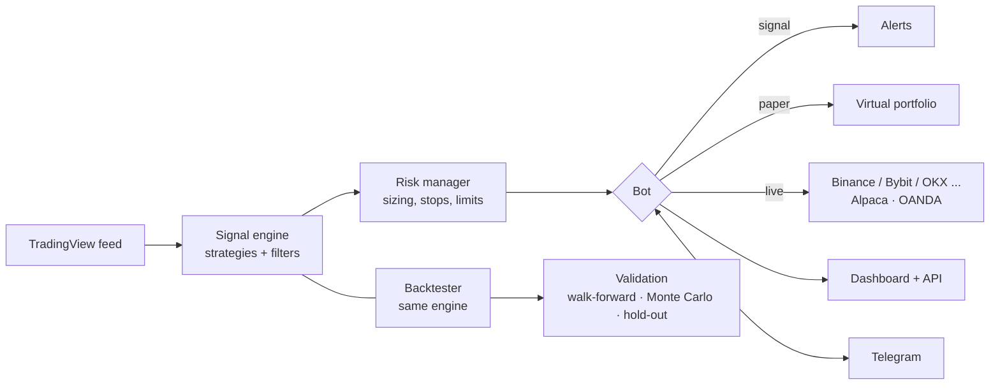

<div align="center">


# TV Hub

**A live TradingView dashboard and a trading bot that tries hard not to fool you.**

Signal alerts · paper trading · live orders · honest backtesting · Telegram control


**English** · [فارسی](README.fa.md) · [Deutsch](README.de.md)

</div>

> [!WARNING]
> **For education and research only. This is not financial advice**, and no strategy here is guaranteed to be profitable. Trading can lose you money. The real-order code paths have only been tested against mocked exchanges and brokers, so **always start on a testnet or demo account.**

<!-- Add a screenshot here:   -->

## Why TV Hub?

Most hobby trading bots show you a pretty equity curve and let you believe it. TV Hub is built the other way round: it assumes that **any search over many ideas will find something that looks good by pure luck**, and it is designed to catch that.

- Backtests fill at the **next candle open** and charge **per-market costs** (crypto, stocks, forex), so results are deliberately weaker than naive ones.
- A result is only called **reliable** after walk-forward, Monte Carlo, a block-bootstrap test corrected for *how many ideas you tried*, and a one-time check on **25% of the data that never influenced any decision**.
- If nothing passes, the report says so instead of showing you the "best of the bad".
- The backtester and the live bot share **one engine**, so what you test is what runs.

## Features

| | |
|---|---|
| **Dashboard** | Live TradingView data, signals, open positions, and a report tab (P&L, win rate, profit factor, drawdown, per-symbol breakdown, CSV export). Installable on your phone (PWA), password protected, English and Persian. |
| **Three modes** | `signal` (alerts only) · `paper` (virtual trading with fees and slippage) · `live` (real orders). |
| **Strategies** | Four built-in (RSI pullback, trend following, breakout, MACD momentum reversal), three combined setups, a no-code combo builder, and your own JavaScript strategies. |
| **AI helper** *(optional)* | Describe an idea in plain words and get a strategy to backtest. The AI never writes code; it only fills a validated rule structure. Works with Claude, any OpenAI-compatible API, or a free local Ollama. |
| **Risk management** | ATR stops, risk/reward targets, trailing stop, risk-based sizing, per-market exposure caps, daily loss limit, max-drawdown halt, cooldowns, trend filter. |
| **Validation** | Walk-forward, Monte Carlo, block bootstrap, multiple-testing correction, sealed hold-out period, and a research ledger that counts your trials. |
| **ML lab** | One model over many symbols, meta-labeling ("take or skip" a strategy's signal), real per-market costs, and an idle-time auto-runner with sealed final checks. |
| **Forward evidence** | Compares the bot's real results with a backtest of the *same weeks*. |
| **MetaTrader 5** | Read-only EAs for long gold/forex history and a live feed (no Python, no API key). |
| **Assistant** | Per-strategy analysis: what each strategy sees now, entry/stop/target, and the simulated probability that target is hit before stop. Numbers come from code; AI only rewords them. |
| **Telegram** | Alerts, daily summary, weekly evidence report, and remote control: `/status` `/positions` `/pnl` `/close` `/halt` `/resume` `/panic`. |
| **Safety nets** | Atomic state files, corruption detection, exchange-side stops, startup reconciliation, watchdog, and a refusal to start on `0.0.0.0` without a password. |

## How it works



## Quick start

**Requirements:** Node.js 18 or newer (20/22 recommended).

```bash
git clone https://github.com/medad21/tv-hub.git
cd tv-hub
```

| Platform | Run |
|---|---|
| Windows | double-click `start.bat` |
| macOS / Linux | `./start.sh` |
| Manual | `npm install && cp .env.example .env && npm start` |

The script installs dependencies and creates `.env` from `.env.example` on first run. Then open **http://localhost:3000**.

The default is `MODE=signal`, which **never opens positions**.

### Docker (24/7 hosting)

```bash
cp .env.example .env     # set MODE and a strong DASH_PASSWORD
docker compose up -d
```

Restarts after a crash or reboot, exits for a restart if market data is silent for 5 minutes, and keeps `state.json` and the event log in a volume.

> [!IMPORTANT]
> **Never expose port 3000 to the internet without HTTPS.** Use [Tailscale](https://tailscale.com) or a Cloudflare Tunnel. To reach the dashboard from your phone set `HOST=0.0.0.0` **and** a strong `DASH_PASSWORD`; the app refuses to start without one in that case.

## Configuration

Everything lives in `.env` (all options are documented in [`.env.example`](.env.example)):

```env
MODE=signal                            # signal | paper | live
SYMBOLS=BINANCE:BTCUSDT,OANDA:XAUUSD   # EXCHANGE:TICKER; empty = built-in list of 25
TIMEFRAME=60                           # 1, 5, 15, 30, 60, 240, D, W (default 15)
APP_LANG=en                            # Telegram, reports, console: fa (default) | en
HOST=127.0.0.1
DASH_PASSWORD=
TELEGRAM_TOKEN=
TELEGRAM_CHAT_ID=
LIVE_CONFIRM=NO                        # must be YES to place real orders
```

Strategy, risk and filter defaults live in `config.js`. Anything you apply from the dashboard is saved to `config.local.json`. Any symbol TradingView offers in `EXCHANGE:TICKER` form can be watched.

## Modes

| Mode | What it does |
|---|---|
| `signal` | Alerts only (dashboard and Telegram) with strategy, suggested entry, stop, target and reasoning. The bot is **long-only**: a sell signal means "close", not "go short". |
| `paper` | Virtual trading with 10,000 units of capital, including fees and slippage. |
| `live` | Real orders on crypto exchanges, US stocks (Alpaca) and forex/gold (OANDA). Needs keys **and** `LIVE_CONFIRM=YES`. A symbol whose broker has no keys stays signal-only. |

## Supported markets

| Market | Provider | Keys |
|---|---|---|
| Crypto spot | Binance, Bybit, OKX, KuCoin, Kraken, Coinbase, Bitget, Gate.io, MEXC (via [ccxt](https://github.com/ccxt/ccxt)) | `*_KEY`, `*_SECRET` (+ `*_PASSPHRASE` for OKX, KuCoin, Bitget) |
| US stocks | Alpaca (paper by default) | `ALPACA_KEY`, `ALPACA_SECRET` |
| Forex and gold | OANDA (practice by default) | `OANDA_TOKEN`, `OANDA_ACCOUNT_ID` |

Use API keys with **trade permission only, never withdrawal.** Whether a service is available to you depends on your country's laws and the service's terms.

## Strategies

| Strategy | Idea |
|---|---|
| Temporary pullback (RSI), *default* | Buy sharp oversold dips, sell when overbought. |
| Trend following | Buy when the short-term average crosses above the long-term one. |
| Breakout | Buy a new 20-candle high, exit on a new 20-candle low. |
| Momentum reversal (MACD) | Buy when momentum turns up, sell when it turns down. |
| Combined setups | Pullback in an uptrend · breakout with momentum confirmation · four-strategy consensus. |

On top of that: build **combos** without code, write **JavaScript strategies** (copy `custom-strategies.example.js` to `custom-strategies.user.js`), or use the **AI helper** with your own key. The key stays on the server and is never sent back to the browser.

> [!CAUTION]
> Custom JavaScript strategies run in the same process, without a sandbox. Only run code you wrote or fully understand.

## Risk management

ATR-based stop (default 2×ATR) · 1:2 risk/reward target · trailing stop after 1R · position size from fixed risk per trade (default 1% of capital) · single-position cap · per-market-group exposure cap · automatic risk reduction on very volatile symbols · max concurrent positions · daily loss limit · max-drawdown halt · cooldown after each close · EMA100 trend filter · multi-indicator confirmation filter · optional partial exits (crypto, live only).

## Backtesting and validation

```bash
npm run backtest          # run the current strategy on historical candles
npm run sweep             # try 270 parameter combinations (train/test ranked)
npm run import-history -- --symbols BINANCE:BTCUSDT --tf 15,60 --from 2023-01
npm run import-crypto     # 1h candles for 8 large pairs since 2021-01 (checksum-verified)
```

A result is labelled **reliable** only if it passes **all** of these: at least 30 trades · profit factor ≥ 1.2 · positive average R · profitable in at least 3 of 5 walk-forward windows · low Monte Carlo loss probability · block-bootstrap significance adjusted for the number of ideas tried · a one-time check on the 25% hold-out.

If `data.binance.vision` is blocked on your network, add `--proxy http://127.0.0.1:10809` (or set `HISTORY_PROXY`). Downloads are compared with what the bot already archived and nothing archived is changed.

<details>
<summary><b>ML lab: multi-symbol model, meta-labeling, auto-runner</b></summary>

<br>

**Multi-symbol test.** Tick several archives with the *same timeframe* (e.g. all `_60`) and run. By default the tested symbol is *not* in training at all, training uses only labels that finished before the test block began, and the permutation test and AUC interval keep the correlation between symbols. A result that is only good on one or two symbols is not a general edge. Runs take a few minutes (limit 20 archives).

**Meta-labeling.** Pick a strategy and run it in the same box. The strategy gives the signals (the same edge-detected signals the backtest and bot use); the model only decides *take or skip*. The report compares against the only fair baseline, **taking every signal**, and the permutation test uses a random choice of the same size. Four or more archives of one timeframe work best.

**Real per-market costs.** Each archive is charged its own market cost from your bot settings (`risk.costs`), converted to ATR units of that symbol, times a factor you can change. Every report shows how many candles it rests on.

**Idle auto-runner.** While the computer is idle (hours and CPU limit you set) it works through *strategy × direction × (timeframe, market) group* with the same test and keeps a leaderboard in `ml-auto.json`. It never trades and never touches the bot. Because searching many combinations always finds something that looks good by luck, it has three guards: the newest candles (last 90 days by default, plus everything archived from now on) are **sealed** and each candidate gets exactly ONE final check on them; every p-value is also shown multiplied by the number of combinations tried; and every run goes into the research ledger.

</details>

<details>
<summary><b>MetaTrader 5: long gold/forex history and live feed</b></summary>

<br>

TradingView only hands out the last few thousand candles. MetaTrader 5 keeps years of gold and forex on your broker's server, and TV Hub can read them without Python or an API key.

**History import**

1. Copy `mt5/TvHubExport.mq5` to MT5's `MQL5\Scripts` folder, compile it in MetaEditor (F7), and drag it onto a chart. Pick symbols and timeframes in the dialog. It only reads history and never trades.
2. Run `import-mt5.bat` (or `npm run import-mt5`). Useful flags: `--dry`, `--dir <folder>` (portable MT5), `--map "GOLD#=OANDA:XAUUSD"`, `--offset ny:7`.
3. In the Backtest tab choose **Data source: MetaTrader**. The live bot keeps using TradingView.

MetaTrader candle times are the broker's server clock, which usually shifts with daylight saving. The import proves the clock by lining candles up with TradingView candles the bot archived (so run a 1-hour backtest on TradingView data with many candles first), and **refuses to store anything it cannot prove**. MetaTrader candles go into a separate archive and are never mixed with TradingView data.

**Live feed (read-only).** Copy `mt5/TvHubLive.mq5` to `MQL5\Experts`, compile it, and drag it onto ONE chart. Every 5 seconds it writes one JSON file per symbol (bid/ask/spread, newest 300 closed candles of M15/H1/H4/D1, open positions, account totals; never your login or name). It cannot trade.

- `GET /api/mt5/live`: folder and file status
- `GET /api/mt5/live/XAUUSD`: price, spread, positions, account totals (`?candles=50` adds candles)
- `GET /api/mt5/live/XAUUSD/structure?tf=60`: market structure on the live candles

Data older than `MT5_LIVE_MAX_AGE_SEC` (default 30) comes back with `fresh: false` and a reason.

> Neither MQL5 script could be compiled in the development environment. Try them on a demo account first.

**Market structure** (`market-structure.js`): swing highs/lows (no look-ahead), support/resistance zones clustered by ATR, trend structure (HH/HL, LH/LL, BOS/CHoCH) and the state of each *break + pullback*. Strategies get it as `ctx.structure()`, `ctx.swingHigh(n)`, `ctx.swingLow(n)`. It measures; it decides nothing about trades.

</details>

<details>
<summary><b>Assistant: per-strategy analysis with optional local AI</b></summary>

<br>

`GET /api/assistant/analyze?symbol=OANDA:XAUUSD&tf=60` returns, for every strategy: what it sees now, whether its entry conditions hold, the entry/stop/target the risk rules would use, the **probability the target is hit before the stop** in the next N candles, what the saved backtest comparison said, and cautions (stale data, wide spread, blocked trend filter).

- **All numbers come from code** (`analysis-context.js`, `market-structure.js`, `forecast.js`). The report works with no AI at all.
- **Probabilities** come from thousands of simulated futures built by chaining blocks of the market's own recent candles at today's volatility, with historical drift removed on purpose: it says how far price tends to travel, never *which way*. `GET /api/assistant/calibration` replays the method over the archive and tells you whether "40%" really happened about 40% of the time.
- **AI only rewords.** With a free local [Ollama](https://ollama.com) (`install-ollama.bat` / `bash install-ollama.sh`, or `ollama pull qwen2.5:7b` and the three `AI_*` lines in `.env`) or any provider in the AI settings, the model receives the facts as JSON and rewrites them. Every number it writes must exist in the facts, otherwise its text is thrown away and the code's text is shown.
- `GET /api/assistant/status` shows whether Ollama is running and what to do if not. In Docker set `OLLAMA_HOST=http://host.docker.internal:11434`.

</details>

## Telegram

Create a bot with `@BotFather` and connect it from the dashboard panel or `.env`. You get signal alerts, startup and outage notices, a daily summary and a weekly evidence report, and you can control the bot **from the registered chat only**. An optional HTTP proxy is supported for Telegram only.

## Before you trade real money

1. `npm test`
2. `npm run backtest` and `npm run sweep` on real data
3. `MODE=paper` for several weeks
4. `MODE=live` on a testnet or demo account (`EXCHANGE_TESTNET=YES`, `ALPACA_PAPER=YES`, `OANDA_PRACTICE=YES`)
5. Only then: real keys, a very small `capitalUsdt`, and `LIVE_CONFIRM=YES`

## Project layout

```
tv-hub/
├── server.js                     HTTP server, dashboard, API
├── bot.js · risk.js · config.js  Bot, risk handling, settings
├── strategy.js · rules.js        Indicators, built-in and rule-based strategies
├── custom-strategies*.js         Your own strategies
├── backtest*.js · significance.js · trials.js · evidence.js
│                                 Backtesting and statistical validation
├── ml*.js                        ML lab (single, pooled, meta-labeling, auto-runner)
├── assistant*.js · forecast.js · analysis-context.js · market-structure.js
│                                 Analysis assistant
├── mt5-*.js · mt5/               MetaTrader 5 import, live reader, MQL5 scripts
├── history-import.js · candle-store.js
│                                 Long history import and candle archive
├── broker-alpaca.js · broker-oanda.js
├── telegram*.js · notify.js · summary.js
├── ai*.js                        Optional AI strategy helper
├── public/                       Dashboard front end (PWA)
└── test*.js                      30 offline test files
```

## Tests

```bash
npm test
```

30 test files, about 1,100 checks, fully offline against mocked exchanges and brokers. They cover risk logic, brokers, backtesting, statistics, alerts, reliability, custom strategies, the AI helper, live-trading safety, the ML lab and more.

## Known limitations

- Market data comes from an **unofficial** TradingView library that may break when TradingView changes.
- Stop loss and take profit are monitored by the app. Exchange-side stops are on by default for crypto, but a trailing stop only moves inside the app (Alpaca and OANDA broker-side stops stay fixed).
- Gaps can cause losses larger than the stop.
- Long history import works for Binance spot only; stocks and forex are limited to what TradingView provides plus the growing local archive (or MetaTrader for forex/gold).
- The English translation covers the whole app, but a rarely seen message may still appear in Persian. Run `I18N_MISSING()` in the browser console to list them.

## Contributing

Issues and pull requests are welcome. Please run `npm test` before opening a PR, and never commit `.env`, API keys or the runtime files listed in `.gitignore`.

## Credits

Created by **Ehsan Bagheryane** ([@medad21](https://github.com/medad21)).

Built on [@mathieuc/tradingview](https://github.com/Mathieu2301/TradingView-API), [ccxt](https://github.com/ccxt/ccxt), [Express](https://expressjs.com) and [ws](https://github.com/websockets/ws).
